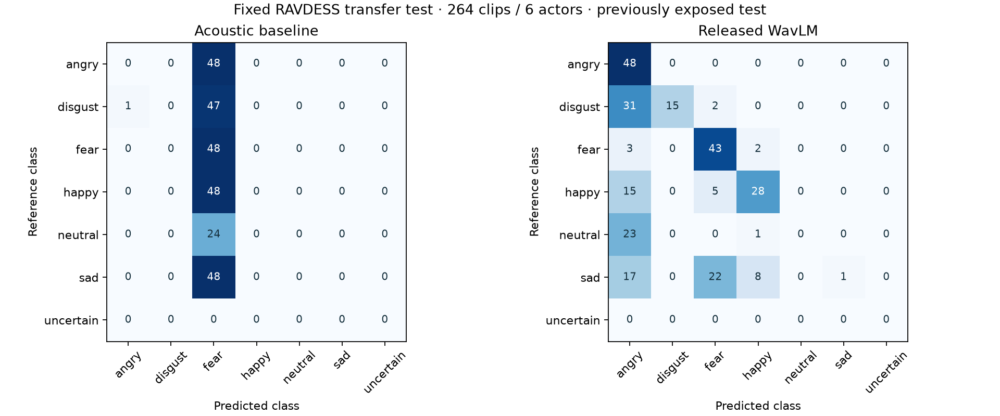

# Vocal-expression validation and inference change

This change improves inference ownership and scheduling, and automatically selects the stronger released head. It does not claim a newly trained checkpoint. The unpublished 83.7% research head is unavailable and was never promoted.

## Same-protocol real audio comparison

Fixed RAVDESS test: 264 original recordings, actors 03/08/11/17/18/22. Every WAV is matched against the SHA256 in `docs/voice_emotion/multicorpus_inventory.json`; duplicate mirror paths count once. These actors do not occur in the inventory development partitions. Both released heads were fitted only on CREMA-D, with preprocessing/selection/calibration recorded in their existing reports. No fitting, threshold search or checkpoint selection ran against these results.

The test was exposed in October 14 research. This is a repeated transfer/reproducibility check, not fresh blind evaluation. Corpus IDs do not independently establish human identity across datasets.

| Model | All-clip accuracy | Macro-F1 | Accepted coverage | Accepted accuracy | First prediction | Median / p95 | Observed peak RSS |
|---|---:|---:|---:|---:|---:|---:|---:|
| Acoustic SVM + actor-held-out calibration | 18.18% | 0.0514 | 0.00% | n/a | 0.016 s | 0.017 / 0.021 s | 0.169 GB |
| Released WavLM-Large + calibrated head | 51.14% | 0.3994 | 69.70% | 61.41% | 6.805 s | 0.444 / 0.553 s | 2.911 GB |

Accuracy/F1 score the exact argmax class before abstention. Coverage and accepted accuracy separately describe the actual uncertain-output policy; no abstained examples are silently removed from all-clip metrics. The baseline accepted none of these transfer recordings. Timing includes real feature extraction and prediction; first prediction includes lazy encoder initialization. Separate fresh processes measured each checkpoint on this Debian 13 CPU host, Python 3.12.14, no CUDA. RSS includes dependencies, encoder and transient allocations. It is not VRAM or an isolated model allocation.

| Model / class | Precision | Recall | F1 | Test support |
|---|---:|---:|---:|---:|
| Baseline / angry | 0.0000 | 0.0000 | 0.0000 | 48 |
| Baseline / disgust | 0.0000 | 0.0000 | 0.0000 | 48 |
| Baseline / fear | 0.1825 | 1.0000 | 0.3087 | 48 |
| Baseline / happy | 0.0000 | 0.0000 | 0.0000 | 48 |
| Baseline / neutral | 0.0000 | 0.0000 | 0.0000 | 24 |
| Baseline / sad | 0.0000 | 0.0000 | 0.0000 | 48 |
| WavLM / angry | 0.3504 | 1.0000 | 0.5189 | 48 |
| WavLM / disgust | 1.0000 | 0.3125 | 0.4762 | 48 |
| WavLM / fear | 0.5972 | 0.8958 | 0.7167 | 48 |
| WavLM / happy | 0.7179 | 0.5833 | 0.6437 | 48 |
| WavLM / neutral | 0.0000 | 0.0000 | 0.0000 | 24 |
| WavLM / sad | 1.0000 | 0.0208 | 0.0408 | 48 |



Exact machine-readable results: [baseline](validation-0.5.0/emotion-baseline.json), [WavLM](validation-0.5.0/emotion-wavlm.json). Historical 814-clip CREMA-D results (51.6% vs 80.8%) are a different test and are not mixed with this comparison.

## Concrete pipeline improvement

The old engine called the same lazy model from capture/features and ASR threads, blocking both paths and allowing concurrent encoder initialization. `ExpressionWorker` owns one model/thread, with one latest display job and at most eight optional caption jobs. Captions are published before expression inference. Overload omits optional estimates with a visible warning; spoken words stay unchanged. File completion drains final caption estimates; explicit stop cancels pending optional work and releases the model.

Live labels require a consistent transition. A change or low-confidence prediction displays uncertain instead of carrying forward a previous confident label. Per-caption probabilities remain raw. The model uses mono 16 kHz, 0.4–30 s windows, existing silence/active-voice/clipping checks and its development-calibrated threshold. Objective prosody is computed independently; noise, accents and natural-conversation robustness are not established. The default is still off until the user enables estimates. WavLM executes on CPU so the 8 GB GPU can serve the active ASR preset.

## Primary references and selection

- [Microsoft WavLM](https://github.com/microsoft/unilm/tree/master/wavlm): pretrained speech encoder, MIT project; existing locally trained six-class head, checksum-pinned Torchaudio encoder and actor-held-out reports. Chosen because its task/provenance match this application and it beat the acoustic head under the same protocol.
- [emotion2vec](https://github.com/ddlBoJack/emotion2vec): credible self-supervised local alternative with nine-category downstream models. Repository MIT licensing alone does not establish every downstream weight/dataset license or exclude benchmark pretraining overlap. No six-class mapping or unsupported accuracy claim was manufactured.
- [SpeechBrain IEMOCAP recipe](https://github.com/speechbrain/speechbrain/tree/v1.0.3/recipes/IEMOCAP): practical local four-class SER recipe, a different label task and licensed corpus. It is not a directly comparable six-class replacement without a new development protocol.
- [RAVDESS primary publication](https://doi.org/10.1371/journal.pone.0196391): Livingstone and Russo (2018), CC-BY-NC-SA-4.0 audio. Mirror software licensing does not replace the audio terms. Evaluation datasets are never downloaded by normal setup.

## Reproduction

Use trusted released joblib artifacts only. The evaluator verifies the checkpoint and every test WAV before deserialization/prediction. Obtain lawful RAVDESS speech files separately; the exact mirror used here is `ZenvilleErasmus/RAVDESS-emotions-speech-audio-only` at `29dc10e08b419f805a29c691c4dbc03da0b2b43e`. No audio is committed here.

```text
python -m scripts.evaluate_voice_models --audio-root PATH_TO_RAVDESS --model models/emotion/emotion.joblib --output reports/baseline
python -m scripts.evaluate_voice_models --audio-root PATH_TO_RAVDESS --model PATH_TO_INSTALLED_WAVLM/emotion.joblib --output reports/wavlm
python -m app.main --verify-inference
```

Existing training reproduction and train-only preprocessing/actor splits are in [voice_emotion_training.md](voice_emotion_training.md). A new independent test corpus, Indian speakers and real RTX 4060 latency are still required for broader claims. Vocal-expression predictions do not establish feelings, intent or health.
