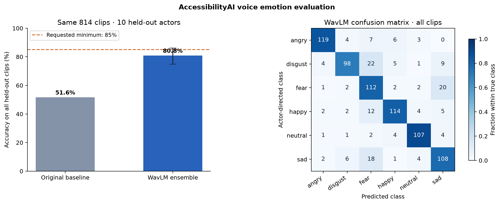

# Voice emotion accuracy work

The requested target is 85–90% classification accuracy on all recordings from
held-out speakers. The user has allowed non-Indian voices for this work. The
published baseline scores 51.6% on 814 CREMA-D clips from ten test actors.
The new model scores **80.8%** on these same clips, with **88.8% accepted accuracy
at 81.9% coverage**. The full-test target is still unmet.

The new training path uses the pretrained WavLM-Large encoder and trains emotion
classifier heads on verified CREMA-D audio. Training a classifier on frozen
pretrained features is transfer learning; the encoder itself is not fine-tuned.
The original encoder weights are unchanged; the emotion heads are newly trained.

| Held-out metric | Original calibrated baseline | WavLM ensemble |
|---|---:|---:|
| Overall accuracy, all 814 clips | 51.6% | 80.8% |
| Macro F1 | 50.7% | 81.2% |
| Accepted prediction accuracy | 71.5% | 88.8% |
| Accepted coverage | 22.9% | 81.9% |

The original baseline was re-evaluated on the downloaded WAVs and reproduced its
published results exactly. The new overall score has a 74.9–86.1% actor-bootstrap
95% interval. This interval and the 80.8% point estimate do not demonstrate the
requested 85–90% overall accuracy.



## Data and evaluation protocol

All 7,442 recordings from 91 actors are retained. Audio obtained from the authors'
official GitLab mirror is checked against every original GitHub Git LFS SHA-256.
The [dataset inventory](voice_emotion/dataset_inventory.json) records the source
revisions, labels, hashes and assignments. The six labels are angry, disgust,
fear, happy, neutral and sad; they describe the actors' requested performances.

The [data audit](voice_emotion/data_quality.json) found three pairs of identical
recordings with conflicting actor labels, within training, validation and test
respectively. They remain in the original benchmark; none cross partitions.
No recording is removed or relabeled based on a model's predictions.

| Partition | Actors | Clips | Use |
|---|---:|---:|---|
| Training | 63 | 5,152 | Fit classifiers and preprocessing |
| Validation | 9 | 738 | Choose layers, classifier and regularization |
| Calibration fit | 4 | 328 | Fit a positive scalar confidence temperature |
| Calibration policy | 5 | 410 | Choose a confidence acceptance threshold |
| Test | 10 | 814 | Final accuracy, confusion matrix and uncertainty interval |

These are the previously published baseline actors, reused for direct comparison.
No test clip or test score chooses a classifier, preprocessing transform,
confidence calibration or threshold. Speaker and identical-audio leakage are
checked when preparing data and when opening the feature cache. Test accuracy is
the top-one prediction on **all** 814 clips. Accuracy on accepted predictions,
coverage, and displayed-label accuracy (abstentions count as incorrect) are
reported separately. A high score on a small accepted subset does not meet the
full-test target.

Positive temperature scaling preserves the classifier's predicted labels, unlike
the older multinomial calibration head. Confidence settings are fitted on actors
separate from model selection. A bootstrap interval resamples whole test actors
to reflect the dependence between recordings of the same voice.

## Reproduce the run

Use the core requirements with matching Torch/Torchaudio 2.8.0 and Python 3.12.
Git LFS is needed for raw audio. Keep datasets and feature caches outside tracked
source; the following POSIX-shell example uses a sibling directory.

```bash
export GIT_LFS_SKIP_SMUDGE=1
git clone --depth 1 --sparse https://github.com/CheyneyComputerScience/CREMA-D.git ../crema-pointers
git -C ../crema-pointers sparse-checkout set AudioWAV
git clone --depth 1 --sparse https://gitlab.com/cs-cooper-lab/crema-d-mirror.git ../crema-audio
git -C ../crema-audio sparse-checkout set AudioWAV
git -C ../crema-audio lfs install --local
git -C ../crema-audio lfs pull --include='AudioWAV/*' --exclude=''

mkdir -p ../emotion-run
curl -fL https://download.pytorch.org/torchaudio/models/wavlm_large.pth -o ../emotion-run/encoder.pth
python -m scripts.train_ssl_emotion prepare --audio ../crema-audio/AudioWAV --pointers ../crema-pointers/AudioWAV --output ../emotion-run/data
python -m scripts.train_ssl_emotion extract --manifest ../emotion-run/data/dataset.json --checkpoint ../emotion-run/encoder.pth --encoder WAVLM_LARGE --precision bfloat16 --output ../emotion-run/features --threads 4
python -m scripts.train_ssl_emotion select --manifest ../emotion-run/data/dataset.json --features ../emotion-run/features --output ../emotion-run/model --workers 3
python -m scripts.train_ssl_emotion evaluate --manifest ../emotion-run/data/dataset.json --features ../emotion-run/features --checkpoint ../emotion-run/encoder.pth --output ../emotion-run/model
```

For PowerShell, set `$env:GIT_LFS_SKIP_SMUDGE = '1'` before the Git commands and
download the checkpoint with `Invoke-WebRequest -Uri <URL> -OutFile <path>`.
The Python commands are the same on Windows. Extraction resumes only when the
dataset, encoder, feature shape and precision match its saved provenance.
Repeated selection into an existing result folder and repeated final test
evaluation are rejected. An interrupted development comparison can use
`--resume-selection`, before its final test has been evaluated. Completed layer
comparisons are preserved; any required voting members are refitted on training
actors only. Start a new experiment without tuning against test results when
changing the model. Classifier fits run independently with three workers and one
BLAS thread per worker; scores are recorded in a fixed candidate order.

WavLM yields a temporal mean and standard deviation from each transformer layer.
Individual layers and fixed layer averages are compared with regularized
logistic classifiers and RBF SVMs. Layer averages also receive a neural classifier
candidate. Concatenated layer features with training-only PCA and a uniform
three-member vote across the strongest distinct layer representations are also
compared. Validation accuracy selects the model, with macro F1 breaking ties.
Selected representations also compare removal of four or sixteen dominant
between-speaker directions, learned only from training-actor averages. This
transform never uses a test speaker's identity or other recordings.
Preprocessing fits only training actors. BF16 is an explicit encoder
precision setting used identically in extraction and desktop inference; pooled
features and classifier calculations use FP32 or scikit-learn's native precision.
The saved CPU thread count is also applied to encoder inference, because BF16
reductions can vary with that setting. Extraction and runtime features are
compared on actual recordings before publishing an evaluated model.

## Use a trusted evaluated model

In version 0.4, **Advanced tools → Models → WavLM voice emotion (CREMA-D)**
downloads the verified encoder and activates the shipped classifier. This is the
desktop route; the following commands serve source checkouts and research runs.

An evaluated folder must contain `emotion.joblib` and `evaluation.json`. Include
its matching `encoder.pth`, or explicitly allow the activation command to fetch
the original checkpoint:

```bash
python -m scripts.activate_emotion --model ../emotion-run/model --download-encoder
```

The command verifies hashes, stores a local copy, and selects it for the next
application session. Enable voice emotion estimates in app Settings. Inference
never downloads weights and silence is rejected before loading the large encoder.
Restore the original baseline with `python -m scripts.activate_emotion --bundled`.
Load only trusted local joblib files, which contain executable Python objects.

## Scope and licenses

The independent listener-label experiment trains against `VoiceVote` in the
upstream `processedResults/summaryTable.csv`. Equally popular labels remain as
multi-label targets. It scored 74.3% majority-label agreement over all 814 test
clips, including 70 ties; on 744 unambiguous clips, accuracy was 74.2% and macro F1
56.1%. Its neutral-only baseline was 55.3% agreement and its sadness recall was
6.7%. These results are a different task from the actor-label benchmark. The
desktop ships the actor-label ensemble as the installable upgrade. This research
code and evaluated artifact are retained for reproducibility, rather than used
to claim a higher actor-label accuracy.

CREMA-D is acted English with twelve sentence texts; this benchmark does not
establish accuracy on Indian languages, spontaneous conversation, background
noise or recordings from a different microphone. Ten test actors also limit the
precision of the measured score. The requested emotion performance and the
emotion a listener perceives may differ.

CREMA-D uses ODbL-1.0/DbCL-1.0. Raw recordings and feature caches are excluded from
GitHub and delivery archives. WavLM's upstream Microsoft MIT license is retained
in [WAVLM-LICENSE.txt](voice_emotion/WAVLM-LICENSE.txt); the pretrained checkpoint
comes from PyTorch's official Torchaudio distribution. Its SHA-256 is
`8c1e5637ae88657f1c54b60ec6b0e0277482b3a071d4be57cdc5715b7921d36e`.
The checkpoint is approximately 1.3 GB and is stored outside Git's normal files.
